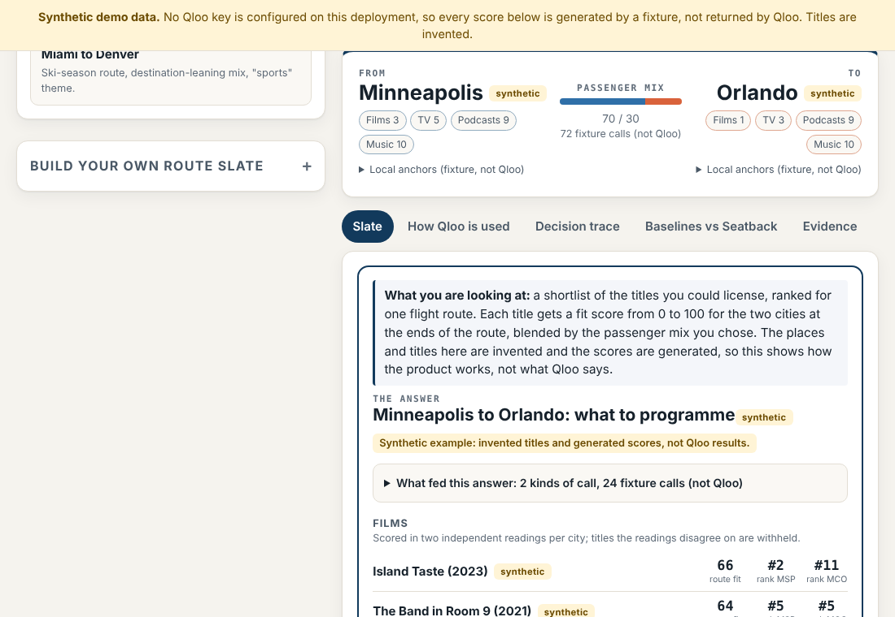

# Seatback

Public repository created: 2026-10-28 (GitHub creation date).

**Route-aware in-flight entertainment programming, grounded in Qloo taste data when a Qloo key is configured. Without a key it runs on clearly labelled synthetic fixtures.**

Seatback is a route-aware programming tool for airline content programmers. Today the path anyone can run is a fixed scripted workflow, and the page says so ("scripted workflow (no LLM)"). The repository also contains an LLM planner loop (`src/agent/planner.ts`) that chooses Qloo tool calls under step and call caps; it is covered by tests with a deterministic fake model only and has not been run against a real model or against Qloo. The label on every run states which workflow ran. You give it:
- a route;
- your assumed passenger mix;
- the catalogue you can license this cycle (typed lines or a CSV).

It returns a slate for that route across films, TV, podcasts and music. Each pick shows its rank in each city where both cities can be scored (a group that only one city can score is labelled "one city only" and shows one rank), and the Qloo calls behind that rank are printed on the card. It then uses Qloo's cross-domain graph to show **which other cities on your network** the same licences suit, an **arrival spotlight** built from the destination's distinctive taste tag, and optional **theme picks** for a programming theme you type ("holiday", "sports").

**Switching to live data is one environment variable:** set `QLOO_API_KEY` (the Qloo client was verified live once, see Live results; the whole flow has not yet been run on live data). With no key, every Qloo call is answered by a synthetic fixture shaped like Qloo's documented responses, and the page says so.

> Built for the [Qloo Agentic Hackathon](https://qloo.devpost.com/). Without a hackathon key the app runs on **clearly labelled synthetic fixtures**: every title gets a "(synthetic)" suffix, every score is generated, and a banner sits on every page. The live results section below is filled in only from real runs.
>
> **Agentic status, stated plainly:** the hackathon asks for an agentic tool. In synthetic mode (all that can be run without a Qloo key) there is no agent behaviour: the scripted workflow is not an agent and the app says so. The LLM planner is the agentic part; it has not yet been shown working on a real model or live Qloo data.

**Demo (static synthetic replay):** https://scubamike124.github.io/seatback-demo/ (static synthetic replay of one result; no live Qloo data; source: [seatback-demo](https://github.com/scubamike124/seatback-demo)). The live Qloo path is the app in this repository, run with `QLOO_API_KEY` (see Run it) · The hosted demo is a public link with no login or access token.
**Demo video:** none yet (the rules do not require one). The static replay above is the walkthrough; the evidence sections below say what is real and what is synthetic.

## Judge summary (read this first)

**The story:** an airline content programmer must choose which of the 36 titles in its sample catalogue to load for Minneapolis to Orlando. Seatback ranks them for both end cities from Qloo taste data, before the licences are bought, shows every Qloo call behind each rank, and says plainly when it cannot tell (it withholds or abstains).

| Question | Honest status |
|---|---|
| Does it call the Qloo API? | The client is verified live: 3 real requests returned HTTP 200 on 2026-10-27 (details under Live results). The whole app flow on live Qloo data has **not** been run yet. |
| What can I open right now? | A static replay of one result on **synthetic** data: https://scubamike124.github.io/seatback-demo/ . It is labelled synthetic on every screen. |
| Agent behaviour (LLM planner, when an LLM is configured)? | The planner loop (`src/agent/planner.ts`) chooses Qloo tool calls under step and call caps. It is tested with a deterministic fake model only; it has not run on a real model. Without an LLM key the scripted workflow runs and says so. |
| How do I run it live? | `cp .dev.vars.example .dev.vars`, add `QLOO_API_KEY`, `npm run dev`. The header pill changes from SYNTHETIC DATA to LIVE QLOO DATA. |
| Licence | Apache-2.0 |


*Screenshot of the static replay (synthetic data, not Qloo results).*

What judges can check in the app is listed under "What judges can check in the app" below. Market sources are under "The problem".

## The problem

Programmers curate in-flight entertainment by route and region, and they pay for audience data to do it.

- Spafax designs strategy from "audience insights, brand tone, and route profiles" ([spafax.com](https://www.spafax.com/?p=3141)).
- Anuvu describes tailoring a title collection for airlines serving specific regions, "predicted to perform well in their desired areas", and says its "partnership with Parrot Analytics" shows why data matters to regional expertise ([Anuvu](https://www.anuvu.com/our-company/insights/post/4374/why-regional-expertise-is-the-secret-ingredient-for-content-curation)).
- One such provider serves "more than 150 airline and 30 cruise-line customers" ([Platinum Equity on Anuvu](https://www.platinumequity.com/our-company/anuvu/)).
- That provider's content business is large. As Global Eagle (rebranded Anuvu in May 2021, [Satellite Today](https://www.satellitetoday.com/business/2021/05/25/global-eagle-rebrands-as-anuvu/)), its "Licensing and services revenue for Media & Content ... [was] $315.4 million" in 2018 ([Form 10-K FY2018, SEC](https://www.sec.gov/Archives/edgar/data/1512077/000151207719000003/ent-10kdocument4q18.htm)). That is one provider, in one year; it is not a market total.
- Anuvu's SVP, media & content, says "I'm seeing a lot of demand for data" around consumption. The same article reports that Anuvu "forged a partnership with Parrot Analytics" ([Runway Girl Network, Apr 2024](https://runwaygirlnetwork.com/2024/04/anuvu-svp-estibaliz-asiain-on-the-content-trends-driving-ife/)).
- Qloo's taste data has reached IFE before. West Entertainment's Jetset AI (2020) was built on Qloo's platform to let airlines personalise their content offerings ([APEX, 30 Nov 2020](https://apex.aero/?p=17674)). **Seatback is the programmer's side of that market:** route by route, before licensing, on the programmer's own catalogue, with every number traced to a call.

In-flight viewing data is inconsistent across fleets: airlines are not "yet able to consistently track across aircraft" what passengers watch ([Runway Girl Network, Feb 2025](https://runwaygirlnetwork.com/2025/02/ife-discovery-popular-on-this-route/)). Where that data exists, it describes the last cycle, after the licences were bought. **Seatback ranks before licensing, from taste data; it does not forecast viewing.**

## Why it needs Qloo

An LLM can list popular films. It cannot tell you how Minneapolis and Orlando differ in taste over *your* licensable titles. In live mode every rank in a Seatback slate comes from Qloo affinities (in synthetic mode the scores are generated fixtures). An LLM never ranks. If (and only if) an LLM key is configured, it writes a short note, validated against the evidence, and an optional LLM-only baseline runs; with no key neither runs, and the app says so.

**What Seatback is compared with.** Three baselines that cannot see the route: newest-first, popularity-first (Qloo's global popularity for each title) and generic taste (the most catalogue-typical genre tags). They pick the same titles on every route; Seatback's slate changes with the route. The mean route fit gap between them is measured on Qloo's own scale, which Seatback maximises, so it is **circular and is not evidence**. Whether a route-specific slate earns more viewing is untested; a pilot with real route-level viewing data would be needed to test it (proposed, not run).

## Extended validity harness (optional second harness)

`scripts/validity-ext.ts` is a separate, stricter version of the validity check above; the original check and the probe are unchanged, so either can be run. It reads a pre-registration file (`prereg/validity-prereg.template.json` is the blank form: 12 cities, 3 items per city, 12 decoys, filler, a seeded null, the decision rule and a call budget), refuses to run unless the file's SHA-256 equals a hash recorded in advance, stops before exceeding its call budget, and ends in one of three outcomes (GO, NO-GO, INCONCLUSIVE) with a matching sentence for the entry. Results are written only under `.private/validity-ext/` (gitignored).

```
node scripts/validity-ext.ts --prereg prereg/validity-prereg.json --dry-run          # hash, planned calls, no key, no network
node scripts/validity-ext.ts --prereg prereg/validity-prereg.json --expected-sha256 <hex> --live
node scripts/validity-ext.ts --prereg <file> --expected-sha256 <hex> --synthetic     # a rehearsal on fixtures; says nothing about Qloo
```
No item is chosen in this repository: the template's titles are empty, and `test/fixtures/validity-prereg.synthetic.json` holds invented titles for the tests only (it cannot be run with `--live`).

## How it works (planner loop with an LLM, scripted workflow without)

The planner loop below is tested only with a deterministic fake model and has not run against a real model. With an LLM key (Gemini free tier via REST, or Workers AI), `src/agent/planner.ts` lets the model choose the next action from a typed tool set (`search_title`, `find_tags`, `read_location`, `read_with_anchors`, `ask_user_to_disambiguate`, `abstain`, `finish`). Code validates every call against a schema, enforces a step cap and a per-attempt Qloo call cap, feeds each result back, treats Qloo and catalogue text as delimited data, and keeps every step (action, stated reason, result) in the decision trace. The numeric scoring in `scoring.ts` never uses the model. If the planner fails or no LLM is configured, the scripted workflow below runs and is labelled as such. The loop tests use a deterministic fake model: they prove the mechanics and guards, not any real model's quality.

| Step | Qloo endpoint | Decision it makes |
|---|---|---|
| 1. Resolve each city | `GET /search` (`types=urn:entity:locality`) | Stops on an unknown place. Asks you to choose if a name is ambiguous (e.g. Portland) |
| 2. Open read per city: what it favours | `GET /v2/insights` + `signal.location.query`, for movie, TV, podcast and artist | Coverage per city, the "popular on this route" leads, and the candidate anchors |
| 3. Choose local anchors | (from step 2) | Qloo's **own** top local artists, TV shows and films. It prefers ones that are not also top in the other city (global hits cannot tell cities apart). An LLM never chooses them |
| 4. Match your catalogue | `GET /search` per title | Flags year mismatches and lists titles it could not match |
| 5. Score your titles in each city, twice | `GET /v2/insights` + `signal.interests.entities` (anchors) + `filter.results.entities` (your titles) | Each domain is scored with anchors from **other** domains (films with music and TV; TV with music and films; music with TV and films), so an anchor can never rank itself. Two independent readings per city. Titles they disagree on are **withheld**. A city whose readings disagree on more than 40% of titles, or overall, or that has too few titles, **abstains** |
| 6. Recover | (retry) | If a city abstains, the workflow retries once with the next local anchors (ranks 4 to 6) or a fallback anchor domain. The retry must also produce two independent readings that pass the same consistency check; otherwise the city abstains, and the trace says so |
| 7. Balance the slate | (code) | Ranks are computed over the same titles in both cities, and the cities are compared only on 5 or more paired titles from two consistent readings each. It blends the two cities by your passenger mix, keeps variety, applies the family-safe rule, the slot counts and a minimum route fit (weak slots stay empty), and makes sure each city gets a title it clearly favours. Picks scored in only one city are labelled "single-end" |
| 8. Audience and momentum | `filter.type=urn:demographics`, `GET /v2/trending` | Age skew of the screen slate, and rising, steady or cooling momentum for the top picks |
| 9. Taste split | taste analysis (`filter.type=urn:tag`) with a location | What defines each city, and what the two share |
| 10. Arrival spotlight | taste analysis tag (step 9) → `GET /v2/insights` + `signal.location.query` + `filter.tags` | Takes the destination's top taste tag that the origin lacks, and reads films with that tag at the destination: arrival-city content to license |
| 11. Theme (optional) | `GET /v2/tags` (`filter.query`) → `filter.tags` reads at both ends | Resolves your theme ("holiday") to a real Qloo tag, marks catalogue titles that carry it, and lists themed leads per city. Says so when no tag matches |
| 12. Network fit | `GET /v2/insights` + `filter.type=urn:entity:destination` + `signal.interests.entities` (top picks) + `filter.geocode.country_code=US` | Cross-domain: which destinations the slate's audience favours. Read **twice** from disjoint halves of the consistency-checked picks; a city the readings disagree on is withheld, and the whole ranking is withheld if the readings disagree overall (tau < 0.3) or fewer than 5 network cities appear in both. Drawn as a map of your network |
| 13. Note and comparison | LLM (optional) | A note validated against the evidence ledger, and the route-blind baselines (plus an LLM-only baseline only if an LLM key is configured) scored on Qloo's data |

**Three read modes, one interface.** The documented pinned mode (location + `filter.results.entities`) was publicly reported by another entrant to collapse for movies: the location acts as a filter ([Taste Atlas findings](https://github.com/4KInc/travels-well)). So Seatback scores with anchors by default. It keeps the pinned mode behind `SCORING_MODE=pinned`, detects a collapse at run time and falls back automatically. The anchor-and-consensus idea follows Taste Atlas's public findings, credited here. Seatback applies it to a different buyer and a different question: one route, two cities, a multi-domain slate from a licensable catalogue.

## Validity check (the headline evaluation)

Before any Qloo call, we wrote down titles strongly tied to each demo city (`src/agent/validity.ts`): Prince and Fargo for Minneapolis, OutKast and *Atlanta* for Atlanta, Nirvana and *Frasier* for Seattle, and so on.

- **Hypothesis:** with Seatback's exact method, each one ranks higher with its own city's anchors than with the other city's.
- **Control:** the same test with every other demo city's anchors standing in for "home" (a shuffled-anchor null, averaged over all of them), which should succeed about half the time.
- **Statistics:** titles from the same route and city share anchor sets, so they are not independent. The p-value is therefore an exact sign-flip permutation test over route-by-city clusters. With 6 clusters the smallest possible p is 1/64. A per-title binomial p is also reported, but labelled optimistic.
- **GO rule:** at least 70% success over 6 or more comparisons, cluster permutation p < 0.05, and a null rate of 60% or less. The rule was fixed on 2026-10-24, before any live call.

`npm run probe` runs this check, along with the pinned, open and anchored checks.

**Live results (client level, one earlier run; not an end-to-end app run):** on 2026-10-27 at 01:44 UTC, `scripts/qloo-minimal-probe.ts` made 3 real requests to `hackathon.api.qloo.com` with an event key: `/search` (a place name that appears nowhere in this repository) returned HTTP 200 with 5 entities; the same request repeated returned HTTP 200 with 5 entities and a later server `Date` header (so it was not cached); `/v2/insights` for movies with a location signal returned HTTP 200 with 3 entities, at least one with a numeric affinity. None carried a synthetic mark and none matched the fixture answer. The probe's overall verdict was **FAIL**, for one reason only: a fourth, deliberately unsupported request (`urn:heatmap`) was expected to return an error but returned HTTP 200 with 255 entities, so the probe's error-path check did not run live (offline tests cover it). No Qloo response data is stored in this repository (the terms forbid it). **Not yet shown:** the full Seatback slate computed from live data, the validity check on live data, and the planner on a real model. Reproduce with your own key: `npm run probe:min -- --yes`.

On synthetic fixtures the check fails, as it should, because the fixture world has no real hometowns: 11 of 18, permutation p = 0.25, null 41 of 80.

## What judges can check in the app

- **Judge mode:** three domestic US routes (Minneapolis to Orlando, Atlanta to Seattle, Miami to Denver), opened with one click: replayed from a stored run when the deployment has one, otherwise computed from synthetic fixtures; the trace says which.
  One-click example versus rebuilt slate: for the same route, the one-click example and a slate rebuilt from the form ("Build slate") show different titles, because the form uses its own sample catalogue; in the example, TV and Music are marked "one city only" (one rank, no route fit), while a rebuilt custom run scores all four groups for both cities.
- **Each pick card** shows its rank in each city over the same set of titles, plus the actual Qloo readings ("Minneapolis A: Qloo insights, signal.interests = [...], affinity 0.62") with links to the full call.
- **How Qloo is used:** a table computed from the run's evidence ledger, listing each kind of Qloo request, the Qloo capability it exercises (in Qloo's own terms: Cultural Data Enrichment, Locality Intelligence, Taste Intelligence, Recommendations, Trends) and the decision it drives. It cannot claim a call that did not happen.
- **At a glance:** slots filled, how strongly the cities differ, the best other network fits, Qloo calls and grounding, in one strip.
- **Network fit map:** your network's cities sized by fit, with route ends, withheld cities and cities with no reading marked, plus the text list.
- **Decision trace:** every step, decision, abstention, retry and fallback.
- **Evidence:** every Qloo call with its exact parameters (the key is never shown) and the values read.
- **Answer card (first screen):** the top picks with three numbers each (route fit, rank in each city); the full slate, evidence links and "How Qloo is used" are one tap away. A list scored at one city only is labelled "one city only" and has no route fit.
- **Baselines vs Seatback:** the route-blind baselines (and an LLM-only row only when a key is configured), what ran, a worked example (labelled synthetic until live) and an on-screen caveat about circularity.
- **Limits:** what a slate does not tell you.
- **CSV:** import a distributor's list (`type,title,year`; there is a template button) and export the slate as a licensing sheet. JSON export includes the full evidence.

## Run it

```bash
node --version                 # 22.18 or newer (runs TypeScript directly)
npm install                    # dev-only: typescript and @types/node, for typechecking
npm run dev                    # http://localhost:8787, synthetic fixtures
cp .dev.vars.example .dev.vars # add QLOO_API_KEY (and optionally GEMINI_API_KEY) for live data
npm run probe                  # first live run: key check, read modes, validity check, verdict
npm test                       # the full suite (counts per tree: see the Tests section below), one file at a time (set TEST_LOCK=/path to serialise with flock)
npm run eval                   # validity check and route sensitivity (labelled synthetic without a key)
npm run typecheck
npm run presubmit              # before submitting: fails while any fill marker, bracketed placeholder, unchosen PASS/FAIL variant, "(synthetic)" label or to-do marker is left in the final text, or the screenshot folder is empty or named synthetic
```

### Deploy as a private preview (plain Node container, e.g. Railway)

`npm start` runs `deploy/node.ts` (Node 22.18 or newer). Set `DEMO_ACCESS_TOKEN` to put the whole app behind a private access link (a PRIVATE PREVIEW banner shows), leave `LIVE_ENABLED=0`, and add keys only in the host's dashboard. Step by step, with every variable name, rollback and teardown: [docs/DEPLOY-RAILWAY.md](docs/DEPLOY-RAILWAY.md); phone test: [docs/IPHONE-DEMO-INSTRUCTIONS.md](docs/IPHONE-DEMO-INSTRUCTIONS.md). `npm run record:examples` (needs a Qloo key) records the three example routes so the page can replay them as stored runs.

**Proxy header and rate limits.** turn `TRUST_PROXY_HEADER` ON only for a header the proxy OVERWRITES on every request; if the proxy merely passes through what the client sent, a visitor can rotate the header value and so rotate their per-visitor allowances and per-IP limits. With it OFF behind a proxy, every visitor shares ONE bucket (safe, but judges can throttle each other).

### Alternative hosts (not the chosen path): Cloudflare Workers (replay-only on the free plan) and Deno Deploy

```bash
npm install                                     # the pre-deploy check typechecks, so dev deps are needed
npx wrangler login
npx wrangler kv namespace create CACHE_KV       # paste the id into wrangler.toml (required: live judge mode refuses to run without it)
npx wrangler secret put QLOO_API_KEY
npx wrangler secret put GEMINI_API_KEY          # optional
npx wrangler secret put ADMIN_TOKEN             # protects the example warm-up endpoint
bash scripts/deploy.sh                          # secret scan, typecheck, tests, then deploy
curl -X POST -H "authorization: Bearer $ADMIN_TOKEN" https://<worker>.workers.dev/api/admin/warm
```

`deploy/deno.ts` is an alternative entry point for Deno Deploy (only exercised against a fake Deno KV, never on real Deno). The documented host is the plain Node container above (Railway).

## Project layout

```
src/qloo/        Qloo client (live and synthetic fixture), parameter allowlists from the docs, private cache
src/agent/       pipeline (scripted workflow), planner (LLM loop), anchors, market reading and consensus, scoring, validity check,
                 evidence ledger, baseline comparison, programmer's note
src/llm/         pluggable LLM: Gemini (default, free tier), Workers AI, or none
src/ui/          single-page app (no framework, strict CSP, no innerHTML with data)
src/worker.ts    fetch handler (Deno Deploy or Cloudflare Workers): routes, streaming NDJSON trace, judge-mode cache, rate limits
scripts/         dev server, live probe, evaluation, deploy and pre-deploy checks
docs/QLOO-NOTES.md   every endpoint and parameter used, with doc links, plus doc gaps found
test/            node:test suites (no network; the live client is tested with a fake fetch)
```

## Robustness

- Every parameter is checked against the documented allowlist for its `filter.type` (`src/qloo/params.ts`); a test fails on any undocumented one, because Qloo silently ignores unknown parameters.
- Bounded retries for 429, 5xx and network errors, honouring `Retry-After` (capped at 5 s), otherwise exponential backoff with jitter. A 429 sets a cooldown that every request in the isolate waits out.
- At most 6 Qloo requests in flight per run; identical concurrent requests share one call.
- A per-run Qloo call budget (ceiling 70 for custom runs, which have no swap test; ceiling 130 for a recorded example, which includes it; measured on synthetic fixtures on 2026-10-26 by running the three examples and two custom routes, Minneapolis-Orlando and Boston-Denver, with the 35-title sample catalogue through the app's own endpoints: examples 69 to 72 calls, custom runs 55 to 57; live call counts are not yet measured), per-visitor and daily caps on Qloo calls and on LLM calls; judge mode replays stored runs when the deployment has them.
- Data gaps (403 for an unsupported type, an empty result) degrade a step with a logged decision; auth, budget and rate-limit errors stop the run with a clear message.

## Data handling

- The Qloo key lives only in a server-side secret. It is sent only in the `X-Api-Key` header to `https://hackathon.api.qloo.com`, and it never appears in URLs, logs, the browser or the trace.
- Qloo responses are cached privately on the server: in memory, or in Workers KV. **No Qloo response data is committed to this repository.** All fixtures are synthetic: every ID starts with `SYN-` and every name ends in "(synthetic)".
- No personal data is collected or sent to Qloo or the LLM. The only inputs are city names and title lists.
- Qloo results are aggregate taste affinities. Seatback does not infer anything about individual passengers.

## Known limits

- Qloo measures the taste of audiences associated with places and anchor entities, not passenger manifests. The passenger mix is your assumption.
- Licence availability, cost and windows are not in Qloo. The "popular on this route" titles are leads to check.
- Content ratings are US-style (MPAA and TV Parental Guidelines), as Qloo documents them.
- Ranks are relative within your catalogue. They are not viewing forecasts, and nothing has been validated against in-flight viewing data. The pilot we would propose is a backtest against one cycle of a provider's route-level viewing data.
- Coverage outside the US in the hackathon environment is unknown. Seatback abstains when coverage is thin.

## Hackathon notes

- **New project:** the earliest commit of Seatback's source is dated 2026-10-24 (source history before this repository was created is private), inside the hackathon period of Sep 30 to Oct 30, 2026 ([official rules](https://qloo.devpost.com/rules), [Qloo resources page](https://www.qloo.com/resources)). This public repository was created on 2026-10-28.
- **Testing access:** the static synthetic replay is live at https://scubamike124.github.io/seatback-demo/ and needs no login or key. The official rules ([Testing](https://qloo.devpost.com/rules)) require the project to stay available free of charge and without restriction until the Judging Period ends (Nov 5, 2026, 11:45 pm ET); the replay is intended to stay up until then
- **Reproducing live results:** you need your own Qloo hackathon key (see Run it). Without one, everything runs on synthetic fixtures, which are labelled as such on screen and never presented as Qloo results.
- **Qloo endpoints used:** `/search`, `/v2/tags`, `/v2/insights` (movie, TV, podcast and artist entities with location, anchor, `filter.results.entities` and `filter.tags`; `urn:entity:destination`; `urn:tag` taste analysis; `urn:demographics`) and `/v2/trending`, all on `https://hackathon.api.qloo.com`. The legacy `/recs` and `/recommendations` endpoints are not used. See `docs/QLOO-NOTES.md`.

## AI assistance disclosure

This project was built with AI coding assistance (Anthropic's Claude, via Claude Code), directed and reviewed by the entrant. That covered the code, the tests and the documentation. The entrant made the product decisions and is responsible for the submission.

## License

Apache-2.0. See [LICENSE](LICENSE). Not affiliated with Qloo, any airline or any content service provider.

## What is tested (offline, no keys; counts re-run 2026-10-30)
<!-- current --> 47 test files, 514 tests, 0 fail. <!-- current --> Full workspace: 503 pass, 9 skipped. <!-- current --> Public repo, a fresh clone of the published files: 501 pass, 13 skipped. The skips are the live Qloo contract tests and the live-LLM planner smoke test, which need keys and print why they skip, plus tests that need internal files or folders that are not published (they are reported as skipped, never as passed). The workspace count needs the sibling `research/` folder of the full workspace; a copy without it skips one more test and passes one fewer, and the public repo never has it. Exactly: a public repo run without a sibling `research/` folder gives the counts above, and with it one more test passes and one fewer is skipped (the rules-facts test skips only when `research/` is absent). `node scripts/mutate-guards.ts` applies <!-- current --> 105 one-line mutations to the critical guards (call and LLM budgets, kill switch, recorder gate, input checks, planner limits, note validator, Deno counter) and requires every one to be caught: <!-- current --> 105 of 105 in one run of the published files by the author (about 7 minutes; re-run it to confirm, it is not part of `npm test`). The planner tests use a deterministic fake model, so they prove the loop's mechanics and guards, not any real model's plan quality. Nothing here has been run against live Qloo.
